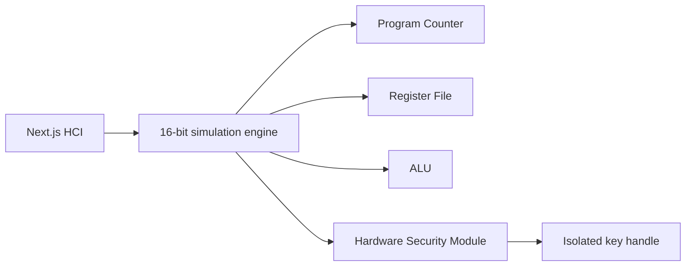

# 16-bit RISC HSM Simulator

Web-based visual simulator for a 16-bit RISC processor and an isolated hardware security module. The UI visualizes registers, ALU, program counter, instruction decode, and key operations.

## Run

```powershell
npm install
npm run dev
```

Open http://localhost:3000. The simulator currently uses a TypeScript engine in the browser. The `wasm/risc16-core` directory contains the Rust/WASM core source for native compilation when Rust is installed.

## Architecture


